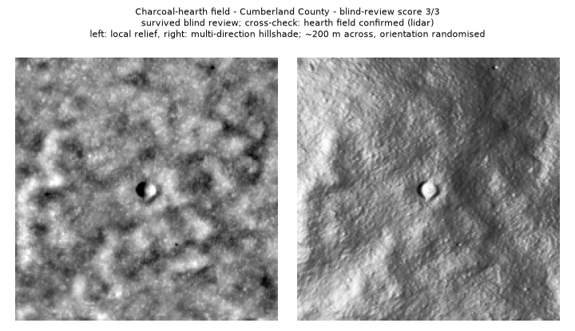
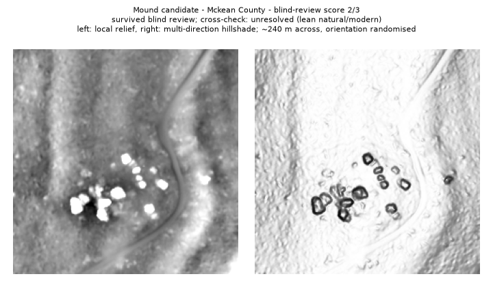
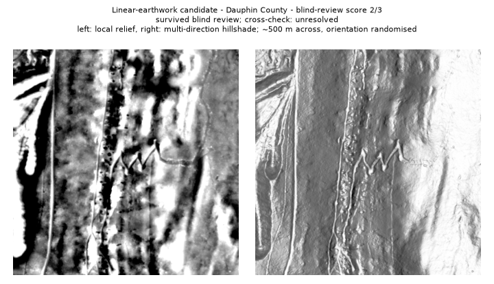
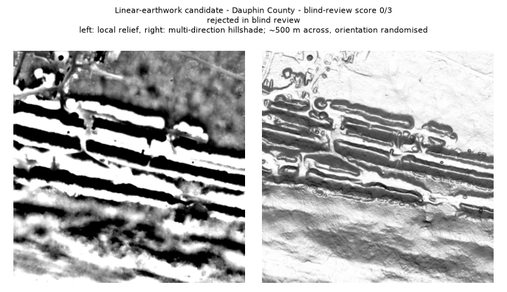

# pa-lidar-ruins

Looking for unrecorded archaeological earthworks in Pennsylvania with free USGS 3DEP lidar,
following the loop in Nate's [*I went looking for lost cities with Claude*](https://bakerbench.substack.com/)
(Baker Bench, Oct 2026):

1. build detectors on bare-earth lidar, 2. prove they work on sites we already know,
3. search big areas, 4. have independent "skeptics" try to kill every find,
5. check survivors against the published record, 6. hand what's left to the people who can judge it.

**This repo is phase 1: steps 1–2 only (detectors + calibration). No wide-area search has been run yet.**


## Site-location policy

Exact locations of candidate (possibly unrecorded) sites are **never** committed here. Search
outputs, candidate coordinates and chips live in the git-ignored `results/private/` and will be
reported privately to the Pennsylvania State Historic Preservation Office (PA SHPO / PHMC) and the
land manager (DCNR, PGC, NPS). Pennsylvania's site files (CRGIS / PASS) are not public, and we only
publish county-level summaries. Calibration uses sites that are already public (OSM, Wikipedia,
NRHP / park pages, and a published open hearth dataset).

## Three target classes, three detectors

| | Target | Detector (all classical except the hearth ranker) |
|---|---|---|
| **A** | Prehistoric mounds (Adena/Hopewell/Monongahela-type conical mounds) | Multi-scale local relief model (LRM = DEM − Gaussian-smoothed DEM at 12/25/50/100 m). For every LRM peak, grow the half-height blob; keep compact, round blobs 6–110 m across; score = relief × circularity × solidity × dome-ness. `palidar.detectors.detect_mounds` |
| **B** | Relict charcoal hearths (RCH): flat round platforms ~8–15 m cut into hillsides, the fuel-making sites of 18th–19th c. iron furnaces | (1) candidates = peaks of a "flat disc inside a sloping ring" contrast map (4–7 m radii); (2) a gradient-boosted classifier on 29 rotation-normalised morphometrics (ring-wise slope profile, upslope-vs-downslope relief = the cut/fill signature, platform planarity, regional slope). `palidar.hearths` |
| **C** | Forts / military earthworks (colonial, Revolutionary, War of 1812, Civil War); also prehistoric enclosures | Hessian ridge (berm) and valley (ditch) maps on a 25 m LRM at 1.5/3/6 m scales; berm pixels with a ditch within 7 m (and vice-versa) = "pairs"; 100 m tiles scored by pair density × (0.3 + orientation diversity). `palidar.detectors.tile_scores` |

## Data

* **Elevation:** USGS 3DEP bare-earth DEM via the 3DEP ImageServer `exportImage`
  (best-available; requested at 1 m in the local NAD83/UTM zone). `scripts/10_provenance.py` checks
  the TNM API: **all 200 calibration windows lie on USGS 1 m DEM projects** (`results/dem_provenance.csv`).
* **Hearth reference:** Carter, Blackadar & Conner (2021) *When Computers Dream of Charcoal*,
  Advances in Archaeological Practice 9(4); open data on Zenodo (CC-BY):
  manual hearth points [4593622](https://zenodo.org/records/4593622) (4,361 points),
  assessed Mask R-CNN predictions [4593767](https://zenodo.org/records/4593767),
  false negatives around SGL 43 [4758647](https://zenodo.org/records/4758647).
* **Known mounds / enclosures / forts:** `data/calibration/known_sites.csv` (87 sites, each with its
  source: OpenStreetMap feature and/or Wikipedia article). Pennsylvania's own mounds were mostly
  destroyed (e.g. McKees Rocks Mound, quarried away) and the survivors are not publicly located, so
  class-A calibration uses 47 mounds and 15 enclosures from the same Upper Ohio Valley tradition in
  OH / WV / KY. Class C uses 25 earthworks in PA, MD, VA, WV, DC and OH.
* **Negative controls:** 60 random 1.2 km windows inside Pennsylvania (`bg`) and 40 windows on PA DEP
  Abandoned Mine Land polygons (dry/flooded strip mines, spoil piles; `aml`), via PASDA.
* **Search-planning layers (phase 2):** PGC State Game Lands, DCNR State Forests and State Parks (PASDA).

Every visible known site was also eyeballed in the combo view and tagged (`visual_audit` column:
`clear_dome`, `faint`, `not_visible`, `platform`, `ring_or_u`, ...). This was one person, not blind
to the detector, and it is reported separately from the headline numbers. About a third of the
"known" mounds are not visible at all in 1 m lidar (plowed down, excavated, or the published
point is off).


## Calibration results (all measured; method stated with each)

### A. Mounds (`scripts/04_eval_mounds.py`, `results/mounds_*.csv`)

Found = a candidate within 30 m of the published point. Background rate = candidates per km² in
random PA windows (an upper bound on false positives, since a few could be real). Fixed threshold
grid (not tuned). Dev/test = odd/even site ids.

| score ≥ | recall, 25 clearly visible domes | recall, all 47 published | dev / test (clear domes) | candidates/km², random PA | candidates/km², strip mines |
|---:|---:|---:|---:|---:|---:|
| 0.5 | 96% | 68% | 91% / 100% | 65 | 114 |
| 1 | 92% | 60% | 91% / 93% | 16 | 40 |
| 2 | 80% | 43% | 73% / 86% | 3.0 | 11.6 |
| 3 | 68% | 36% | 64% / 71% | 0.9 | 4.8 |
| 5 | 44% | 23% | 55% / 36% | 0.17 | 1.1 |

Inside its own 1.2 km window the known mound was the #1-ranked candidate for 13 of 47 sites and in
the top 5 for 21 (median window has 238 candidates). The detector misses ring/U-shaped mounds,
platform mounds and loaf-shaped mounds, which it wasn't built for. In practice: at score ≥ 2 it finds
about 4 in 5 clearly visible mounds and returns about 3 candidates per km² of Pennsylvania, roughly
4× that on strip-mined land.


### B. Charcoal hearths (`scripts/05_eval_hearths.py`, `results/hearths_*`)

*Closed-world test:* the full lidar image around State Game Land 43 (Berks/Chester Co., next to
Hopewell Furnace NHS), where Carter et al. visually checked every model prediction and logged the
hearths their model missed. That gives 908 reference hearths. The ranker was **trained on the west
half and tested on the east half** (516 reference hearths). Found = a detection within 6 m.

| p ≥ | recall | precision (vs reference) | detections/km² |
|---:|---:|---:|---:|
| 0.5 | 78.5% | 14.7% | 46 |
| 0.7 | 72.1% | 20.3% | 31 |
| 0.8 | 68.4% | 26.3% | 22 |
| 0.9 | 61.0% | 36.7% | 14 |
| 0.95 | 49.0% | 51.0% | 8 |

The reference is itself incomplete, so measured precision is a lower bound. A **blind visual audit**
(`scripts/07_audit_chips.py`, `results/hearths_visual_audit.json`) looked at 30 random unmatched
detections at p ≥ 0.9, shuffled with 10 matched ones as controls. All 10 controls were judged hearth or
maybe. Of the 30 unmatched, 5 looked like hearths and 2 were maybes, which puts precision at p ≥ 0.9
around **47–51%**. This is indicative only (one rater, n = 30). The real false positives were road and
trail junctions, road cuts, stream banks and ditches.

*Independent recall:* in 12 four-km² windows in other game lands, the authors' manual hearth points
(581, not exhaustive, so recall only) gave recall of 88.5% / 80.9% / 75.0% / 58.2% at p ≥ 0.3 / 0.5 / 0.7 / 0.9
(per-window 44–80% at 0.9). Detection density at p ≥ 0.9 is a median of 3.5/km² in random PA windows
and 3.5/km² on strip-mine windows. Random PA forest genuinely contains hearths, so that isn't all false.


### C. Military earthworks and enclosures (`scripts/06_eval_earthworks.py`, `results/earthworks_*`)

This is a tile-ranking test like Nate's pueblo test: each 1.2 km window is cut into 100 m tiles (14,400
background tiles: 8,640 random PA and 5,760 strip-mine). For each known site we take its best tile
within 150 m (250 m for enclosures, whose points are the centres of 200–400 m circles) and ask what
fraction of background tiles score higher. Two parameter sets were compared on the dev split
(`small` vs `multi` scales). `multi` was better on dev (military median 7.0% vs 10.3%) and is the
one reported.

| class | sites | median % of random-PA tiles scoring higher | median % of strip-mine tiles scoring higher | in top 5% vs random PA |
|---|---:|---:|---:|---:|
| military, clearly visible | 12 | 3.0% | 13.9% | 8 / 12 |
| military, faint / not visible | 13 | 7.6% | 27.3% | 5 / 13 |
| military, test split only | 12 | 5.7% | 22.5% | 6 / 12 |
| enclosures (mostly plowed Hopewell) | 15 | 8.1% | 28.5% | 6 / 15 |

**C is the weakest detector.** It separates forts from ordinary Pennsylvania terrain moderately well,
but strip-mine spoil ridges, road cut-and-fill and stream banks produce the same berm-next-to-ditch
signal. The best-preserved Hopewell circles (Newark Great Circle, Observatory Circle) score low
because their walls are much wider than the filter scales.


## What's hard

* **Coal country.** Strip-mine spoil and highwalls are the dominant false positive for all three
  detectors: mounds come out about 4× denser per km² there, and earthwork tiles score far higher.
  Phase 2 must mask PA DEP *Digitized Mined Areas* + AML polygons before ranking.
* **Roads and drainage.** Cut-and-fill road benches, trail junctions and stream banks mimic hearth
  platforms and berm/ditch pairs.
* **Ground truth is thin and biased.** PA's site files aren't public. Many "known" mounds are invisible
  in lidar (plowed or excavated), and OSM points are sometimes off the feature. Known forts are mostly
  restored park sites, which are better preserved than whatever is still undiscovered.
* **Base rates.** Even 3 candidates/km² over a 1,000 km² forest is 3,000 leads. The skeptic and
  historic-record steps (4–5) have to do most of the filtering, as they did for Nate.

## Phase 2: masks, upgraded detectors, first search (Oct 2026)

Every number below comes from a run in this repo. The files are listed with each table. Candidate
locations are not published (see the site-location policy). The public outputs are counts by county
and class, the method, the control metrics, and a de-georeferenced image gallery.

### Search area and masks (`scripts/13_aois_masks.py`, `src/palidar/search.py`)

* **Public land only:** state forests, state game lands, state parks and the Allegheny NF (PASDA),
  1,611 polygons covering 19,550 km².
* **Excluded areas:**
  * DEP Digitized Mined Areas (26,244 polygons)
  * OSM quarries and spoil heaps (678)
  * OSM roads (1.83 M), rail (37,792), waterways (98,660), water bodies (51,248) and buildings (2.36 M),
    each buffered by its type
* **Search tiles:** areas were cut into 4 km UTM tiles with 60 m padding over the 1 m 3DEP DEM. Only
  unmasked pixels count as searched.

| class | areas | searchable km² (measured) | 4 km tiles |
|---|---|---|---|
| hearths | Michaux, Rothrock, Weiser, Tuscarora, Buchanan, Bald Eagle SFs; French Creek/SGL 43 + 10 km | 2,315.7 | 473 |
| mounds | public land within 1.5 km of the Ohio, Allegheny, Beaver, Monongahela, Youghiogheny (incl. ANF/Warren) | 372.2 | 127 |
| earthworks | 1863 Gettysburg-campaign counties (incl. Harrisburg/Camp Hill, South Mountain); Forbes & Braddock road corridors | 986.0 | 304 |

Per-area coverage is in `results/search_coverage.csv`. Wall-clock time on one MacBook was about
80 minutes for all three classes running in parallel. Download speed was the bottleneck.

### Detector upgrades, before vs after (same phase-1 tests)

**B. Hearth CNN** (`scripts/12_hearth_cnn_data.py`, `14_train_hearth_cnn.py`, `src/palidar/cnn.py`)

* **Model:** a 4-block CNN that reads 48×48 m patches with three channels (10 m local relief, slope,
  3 m local relief). It re-scores the phase-1 geometric candidates.
* **Training data:**
  * Carter et al. manual points, in 2 km cells. A spatial holdout puts cells within 3 km of the
    phase-1 recall windows and a random 20% of 20 km blocks into test, and drops training cells
    within 2.5 km of any test cell. That gives 156 train and 108 test cells.
  * SGL 43 west half
  * strip-mine dev windows as hard negatives
* **Training:** 14 epochs on Apple MPS. The last epoch was kept, with no model selection on test data.

| test (never seen in training) | phase-1 GBM | CNN | file |
|---|---|---|---|
| SGL 43 east, closed world, p ≥ 0.9: recall / precision | 61.0% / 36.7% | **95.9% / 57.7%** | `results/hearths_sgl43_test_curve_*.csv` |
| SGL 43 east, p ≥ 0.95: recall / precision | 49.0% / 51.0% | 94.8% / 59.8% | same |
| 12 recall windows (held-out cells), p ≥ 0.9: recall | 58.2% | **94.0%** | `results/hearths_windows_compare.csv` |
| random-PA test windows, p ≥ 0.9: median detections/km² | 4.17 | 0.00 | same |
| strip-mine test windows, p ≥ 0.9: median detections/km² | 3.47 | 0.69 | same |

The phase-1 visual audit found that many "false positives" at SGL 43 are real hearths missing from
the reference. Read the precision numbers as a lower bound.

**C. Strip mine vs earthwork** (`scripts/17_earthworks_v2.py`, `results/earthworks_v2_*`)

* **New tile features:** orientation parallelism, local-relief amplitude and roughness, and
  ridge/valley balance. `tile_scores` now computes them.
* **Variants:** three regularised logistic models, plus a "phase-1 score × (1 − parallel)" variant.
* **Selection rule:** fitted on the dev split, with the variant chosen on dev only (`lr_full`).
* **Test-split result:** the median share of negative tiles that score above each known site
  (lower is better).

| test split, all sites | random-PA tiles above | strip-mine tiles above |
|---|---|---|
| phase-1 score (n = 19) | 5.6% | 21.3% |
| v2 `lr_full`, picked on dev | 7.9% | 15.2% |

**Honest verdict:** v2 is better against strip mines but worse against ordinary terrain, so it did not
beat phase 1 overall. The search therefore ranks by the phase-1 score and records the v2
probability as a secondary column. On dev, v2 looked like a large gain (enclosures 8.9% → 0.6% of
background tiles above), but it did not carry over to test. That gap is overfitting, from training
on 21 sites.

### Search funnel (`scripts/15_search.py`, `16_search_cnn.py`, `18_candidates.py`, `results/search_stage_counts.csv`)

**Hearths**

| stage | count |
|---|---|
| geometric candidates in searchable area | 4,000,810 |
| phase-1 GBM p ≥ 0.9 (shown for comparison) | 13,957 |
| CNN p ≥ 0.9, deduplicated | 13,372 |
| …of which match Carter et al. points (30 m) | 1,335 |
| hearth fields (DBSCAN, 250 m, ≥ 5 hearths) | 349 |
| fields with < 20% of points in Carter et al. | 308 |
| …and > 5 km from any GNIS "Furnace" name | 242 |

**Mounds**

| stage | count |
|---|---|
| domes with score ≥ 1 | 13,395 |
| score ≥ 2 | 2,828 |
| mound-sized (0.5–8 m high, 8–50 m wide), deduplicated | 2,307 |

**Earthworks**

| stage | count |
|---|---|
| 100 m tiles scored | 102,447 |
| above the random-PA 99.5th percentile | 60 |
| grouped | 38 |

Final-stage counts by county are in `results/search_counts_by_county.csv`.

**What "new" means here:** a hearth field is "new" only relative to the Carter et al. dataset, which
covers State Game Lands. Hearths in Michaux and Rothrock SFs are well known locally and to the
forest managers. These counts measure the detector, not discoveries.

### Skeptic review with hidden controls (`scripts/19_review_chips.py`, `results/review_controls.csv`)

**Set-up**

* **Chips reviewed:**
  * the top 20 mound candidates (at most 5 per county)
  * the top 20 earthwork groups
  * the 10 largest "new" hearth fields
* **Hidden controls mixed in:**
  * known sites: 8 mounds, 9 forts and 3 enclosures, and 5 SGL 43 field-confirmed hearths
  * 30 negative chips from random-PA and strip-mine windows
* **Blinding:** all 105 chips were shuffled under opaque ids. One AI reviewer (this agent) scored
  them blind, 0 to 3 for "the target class is present", before looking at the key.

**Caveats**

* There was only one reviewer.
* Known sites often sit in parks, so the setting can give them away.

| group | candidates: mean / n ≥ 2 | known-site controls: mean / n ≥ 2 | negative controls: mean / n ≥ 2 |
|---|---|---|---|
| hearths | 2.70 / 9 of 10 | 2.00 / 4 of 5 | 0.00 / 0 of 10 |
| mounds | 0.40 / 1 of 20 | 2.25 / 6 of 8 | 0.10 / 0 of 10 |
| earthworks | 0.35 / 2 of 20 | 2.17 / 9 of 12 | 0.00 / 0 of 10 |

### Record cross-check (`scripts/20_crosscheck.py`)

* **Sources checked** for the 21 candidates that scored ≥ 1:
  * the oldest USGS topo available (1892–1936 editions) and a 1:24k edition from 1944–1971, via TNM / topoView GeoTIFFs
  * current NAIP imagery
  * OSM features within 200 m
  * GNIS names within 1 km
* **Hearth fields:** 9 of 9 were confirmed as hearth fields.
* **Mound candidate (McKean Co.):** unresolved, probably natural or modern. It is a knob-and-pit
  cluster in oil-field country, with tracks and a pipeline nearby and nothing on the 1936 or 1966 topos.
* **Zigzag linear (Dauphin Co.):** unresolved. It could be a skid road or a trench, and nothing
  appears on the 1892 or 1947 topos.
* **Earthwork candidate (Somerset Co.):** rejected. The 1971 topo shows strip-mine spoil at the spot.

### Gallery (`figures/gallery/`, `scripts/21_public_gallery.py`)

Lidar-only chips, labelled by class, county and review outcome. Rejects are included so the false
positives are visible too.

**De-georeferencing:**

* plain PNGs with every metadata chunk stripped
* no coordinates
* orientation randomised
* no scale bar, roads or place names






### Takeaways

1. **The hearth CNN is a large, test-verified improvement** and is ready for statewide use.
2. **Mounds are the weak link.** Ranking by dome score favours 5–8 m natural knobs, and 19 of the
   top 20 failed review. Next step: re-rank for 1–3 m domes on flat terraces and add hard-negative training.
3. **Earthwork detection in mining country** stays dominated by spoil and benches even after masking.
   The best leads came from areas without mining.
4. **No candidate is presented as a discovery.** Unresolved leads go into a private report draft
   for PA SHPO. Nobody has been contacted.

## Reproduce

```bash
uv sync
uv run python scripts/01_reference_layers.py   # PASDA layers -> data/raw/ref
# hearth reference: download the three Zenodo files above into data/raw/rch/
uv run python scripts/02_build_windows.py      # windows.csv + ~200 DEM windows (~1.5 GB)
uv run python scripts/04_eval_mounds.py
uv run python scripts/05_eval_hearths.py
uv run python scripts/06_eval_earthworks.py multi
uv run python scripts/07_audit_chips.py 0.9    # private blind-audit grid
uv run python scripts/08_figures.py
uv run python scripts/09_tables.py
# phase 2
bash scripts/11_download_phase2.sh             # Geofabrik PA OSM, DEP mined areas, GNIS (md5/size checked)
uv run python scripts/13_aois_masks.py         # public land, exclusions, search tiles
uv run python scripts/12_hearth_cnn_data.py && uv run python scripts/14_train_hearth_cnn.py
uv run python scripts/17_earthworks_v2.py
uv run python scripts/15_search.py hearths && uv run python scripts/16_search_cnn.py
uv run python scripts/15_search.py mounds && uv run python scripts/15_search.py works
uv run python scripts/18_candidates.py && uv run python scripts/19_review_chips.py
# (blind scoring -> results/private/review/scores.csv)
uv run python scripts/20_crosscheck.py && uv run python scripts/21_public_gallery.py
uv run python scripts/22_private_report.py
uv run pytest && uv run ruff check .
```

Raw data, DEMs and caches are git-ignored. `02_build_windows.py` also fetches the full SGL 43 lidar extent
(12.5 × 9.6 km) used for the hearth closed-world test.

## License

MIT, see [LICENSE](LICENSE). Hearth reference data © Carter, Blackadar & Conner, CC-BY 4.0.
Map data © OpenStreetMap contributors (ODbL). Elevation: USGS 3DEP (public domain).
